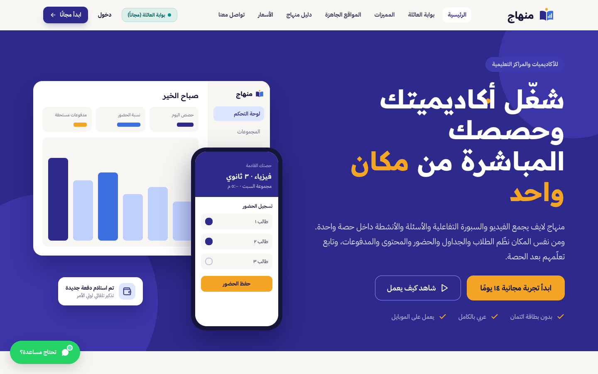
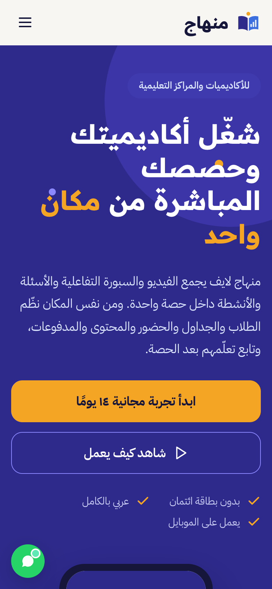
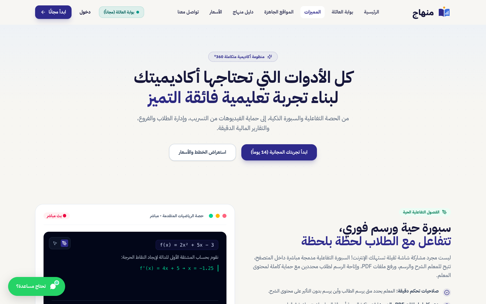
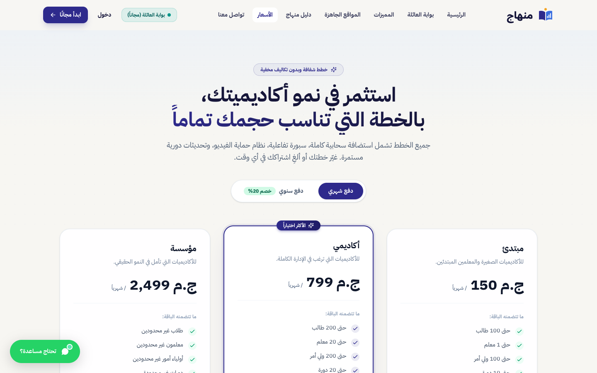
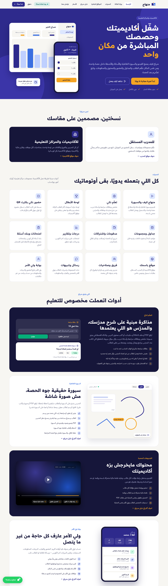

# Menhaj (منهاج)

> Arabic-first SaaS for running academies and training centers.

**Live:** [menhaj.online](https://menhaj.online/) · **Role:** Founder & lead developer · **Period:** 2026 – present · **For:** Own product

        

## Overview

Menhaj gives an academy one place to run its daily work: students and groups, courses and live sessions, attendance, invoices and payments, parents' follow-up and interactive learning. Each academy gets its own subdomain (or its own domain) and its own isolated database.

## What it does

- Students, groups, courses, schedules and live classes
- Attendance with parent notifications
- Finance: invoices, installments, discounts, refunds, cashbox and teacher payouts
- Online payments (Paymob, Fawry)
- Parent / family portal and student portal
- Interactive learning games and AI study tools
- Arabic RTL web app + Flutter mobile apps (staff, student & parent)

## Engineering highlights

- Multi-tenant: landlord database + one database per academy, resolved by subdomain / custom domain
- 29 business domains organised as Actions, Services and DTOs (~195 action classes)
- ~370 automated test files, PHPStan level 7, Laravel Pint
- CI/CD with GitHub Actions to a Linux VPS
- 540+ commits since June 2026

## Screenshots (live site)

  
  
  

Full home page

---

Source code is private (client / commercial project). This repository documents the work only.

Built by **Ahmed Gamal** — Senior Laravel Developer · [LinkedIn](https://www.linkedin.com/in/wzcoder/) · [GitHub](https://github.com/ahmed-gamal-dev)
